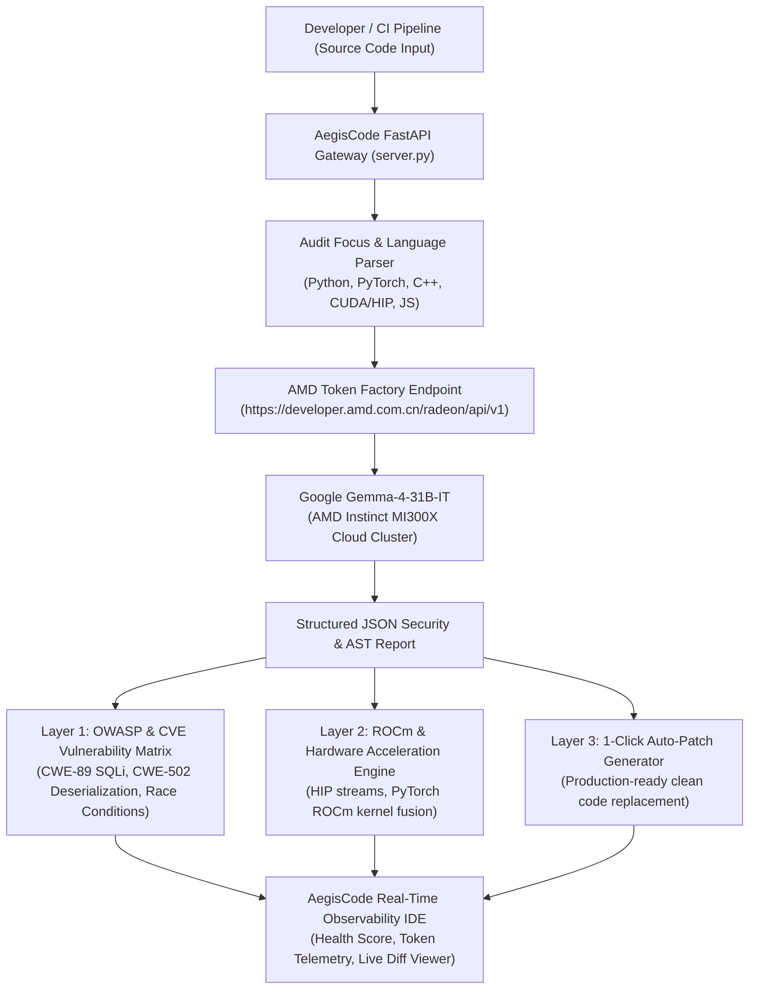

# 🛡️ AegisCode AMD — Autonomous Code Security & ROCm Performance Auditor
> **AMD Developer Hackathon: ACT III**  
> **Track:** DevTools & Intelligent Industry / Autonomous Agents  
> **Target Awards:** AMD 1st Prize ($5,000) + Google Gemma Partner Award ($5,000)  
> **Infrastructure:** Powered natively by AMD Token Factory & Google Gemma-4-31B-IT on AMD Instinct™ MI300X GPUs.

---

## 📌 Executive Summary
Modern software engineering teams face two compounding bottlenecks:
1. **Critical Security & Concurrency Flaws:** Undetected SQL injection, unsafe deserialization (RCE), thread deadlocks, and GPU memory (VRAM) leaks cause catastrophic production outages and data breaches.
2. **GPU Optimization Gap:** Most developers write standard CPU or naïve CUDA code, failing to exploit the massive **192GB HBM3 memory bandwidth** and matrix compute capabilities of **AMD Instinct MI300X** accelerators with the open ROCm ecosystem.

**AegisCode AMD** is an autonomous, multi-model static analysis and hardware-acceleration copilot. Running directly on **AMD Radeon Cloud via AMD Token Factory**, it leverages Google DeepMind's flagship **Gemma-4-31B-IT** model to deliver forensic security vulnerability detection (OWASP/CWE), concurrency verification, ROCm kernel optimization advice, and 1-click deterministic patch generation.

---

## 🏛️ System Architecture



---

## 🛡️ Core Capabilities & Technological Depth

### 1. Multi-Model Inference on AMD Instinct MI300X
Natively harnesses the AMD Token Factory shared inference infrastructure. Allows instant switching between:
- **Google Gemma-4-31B-IT:** 31B parameters, 262k context window — world-class deep reasoning for complex security flaws and AST verification (qualifies for the **$5,000 Google Prize**).
- **DeepSeek-V4-Flash / Qwen3.8-27B:** Sub-3-second ultra-low latency analysis for rapid developer feedback loops.

### 2. Comprehensive Security & OWASP Defense
Scans for high-severity vulnerabilities with standard Common Weakness Enumeration (CWE) mappings:
- **CWE-89:** SQL Injection vulnerabilities via dynamic string interpolation.
- **CWE-502:** Insecure Deserialization (`pickle.load()`) allowing Remote Code Execution (RCE).
- **CWE-798:** Hardcoded production API keys, secrets, and credentials.
- **CWE-400 / 362:** PyTorch un-detached tensor VRAM memory leaks and multi-threaded lock-order inversion deadlocks.

### 3. AMD ROCm & Hardware Acceleration Advisor
Provides domain-specific optimization directives tailored to AMD hardware:
- Recommends PyTorch ROCm native operators.
- Highlights asynchronous memory transfer opportunities using AMD HIP streams.
- Advises on leveraging AMD MI300X's 192GB unified VRAM pool for large model training without CPU offloading.

### 4. 1-Click Deterministic Patch Generation
Rather than vague suggestions, AegisCode outputs complete, validated drop-in code patches with 1-click clipboard copy to immediately remediate detected issues.

---

## ⚡ Quick Start & Verification

### Prerequisites
- Python 3.10+
- `fastapi` and `uvicorn` (`pip install fastapi uvicorn`)

### Run in 1 Click (Windows)
Double-click `run.bat` or run in terminal:
```bash
python server.py
```
Open your browser to:
👉 **`http://127.0.0.1:8000`**

### Live Verification Steps:
1. Click any of the 3 pre-loaded developer sample cases:
   - **Sample 1:** PyTorch/CUDA VRAM Memory Leak & Pickle RCE
   - **Sample 2:** C++ Lock-Order Inversion Concurrency Deadlock
   - **Sample 3:** FastAPI SQL Injection & Hardcoded Secret
2. Click **"Run Autonomous Forensic Audit on AMD GPU"**.
3. Inspect live telemetry:
   - Health Score (e.g. `20/100 - Critical Flaws`)
   - Exact CWE IDs, line numbers, and mitigation breakdowns.
   - Live tokens generated and model latency.
4. Switch to the **"Patched Code"** tab to view and copy the fully secured drop-in replacement code.
5. Switch to the **"ROCm Acceleration"** tab for AMD GPU performance recommendations.

---

## 🏆 Hackathon Submission Metadata (lablab.ai)

* **Project Title:**  
  `AegisCode AMD — Autonomous Code Security & ROCm Performance Auditor`

* **Selected Track:**  
  `Track 1: Intelligent Industry / DevTools & Autonomous Agents`

* **Target Partner Awards:**  
  `AMD Prize ($5,000) + Google Gemma Partner Award ($5,000)`

* **Short Description:**  
  `An autonomous multi-model code auditor and hardware accelerator powered by AMD Token Factory and Google Gemma-4-31B-IT, detecting critical OWASP vulnerabilities, VRAM leaks, and concurrency deadlocks with 1-click auto-patching.`

* **Technology Tags:**  
  `AMD Token Factory, AMD ROCm, Google Gemma-4-31B-IT, DeepSeek-V4-Flash, PyTorch, FastAPI, Tailwind CSS, Python`

---

## 📜 License
MIT License. Built for the **AMD Developer Hackathon: ACT III** (AMD × lablab.ai).
